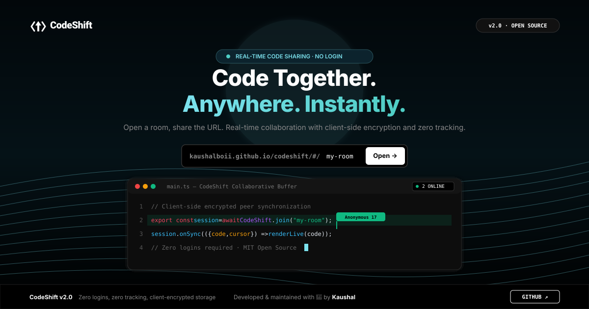

# ⚡ CodeShift — Real-Time Collaborative Code Sharing

> *"Think together. Code without limits — instant encrypted code sharing with zero friction."*

[](https://opensource.org/licenses/MIT)
[](https://kaushalboii.github.io/codeshift/)
[](https://microsoft.github.io/monaco-editor/)
[](#-minimal-black--white-monochrome-theme)
[](#-privacy--security-guarantee)

---

## 🌐 Live Application

👉 **Try it Live**: [https://kaushalboii.github.io/codeshift/](https://kaushalboii.github.io/codeshift/)



---

## 🌟 What is CodeShift?

**CodeShift** is an open-source, ultra-fast real-time collaborative code editor. Anyone with a room URL can collaborate instantaneously — **zero accounts, zero passwords, zero email collection, and zero tracking cookies**.

All code edits are compressed client-side with LZW and encrypted locally in your browser before synchronization.

---

## ✨ Key Features

- **🚀 Zero Login Friction**: Open any room URL (e.g. `kaushalboii.github.io/codeshift/my-room`) and immediately start coding together. No sign-up, no onboarding, no friction.
- **🔒 Client-Side Payload Encryption**: Payloads are compressed with LZW and encrypted locally via AES-GCM before ever leaving your device. Cloud relays store only encrypted ciphertext.
- **👥 Live Collaborative Presence (Real-Time Peer Cursor)**:
  - Active line highlighting with collaborator accent colors.
  - Floating remote cursor badges with pointing carets (e.g. `[ Anonymous 17 ]`).
  - Dual-layer synchronization via Firebase Realtime Database and local `BroadcastChannel`.
- **💻 Monaco Editor (Full VS Code Power)**:
  - Rich syntax highlighting for JavaScript, TypeScript, Python, HTML, CSS, Rust, Go, C++, SQL, JSON, Markdown, and more.
  - Smart indentation, bracket colorization, line numbers, word wrap, and configurable tab sizes.
  - Authentic macOS terminal controls: Red (`#ff5f57`), Yellow (`#ffbd2e`), and Green (`#28c840`).
- **🖤 Minimal Black & White Monochrome Theme**:
  - Pure obsidian black void (`#000000`), crisp white action buttons, and refined typography.
  - Focus-centric design: only Monaco code syntax features color for optimal readability.
- **🌊 Interactive 3D Monochrome Particle Wave Platform**:
  - Live interactive mathematical particle wave running on HTML5 Canvas.
  - Realistic 3D perspective sine waves reacting dynamically to mouse movement and viewport resize.
- **🏷️ Authentic Developer Logo `[ >_ ]`**:
  - Clean, hand-crafted terminal prompt and cursor mark inside a high-contrast tile.
- **🛡️ Clean Path Routing (No `#` Hash)**:
  - Direct clean URLs: `https://kaushalboii.github.io/codeshift/room-name` natively supported via GitHub Pages SPA routing.
- **📜 Built-in Privacy Policy Modal**:
  - Strict zero-logging and zero-tracking commitment with zero third-party analytics.

---

## 🔄 How CodeShift Works (Architecture & Data Flow)

```
┌─────────────────────────────────┐               ┌─────────────────────────────────┐
│     User A (Browser Client)     │               │     User B (Browser Client)     │
│  "kaushalboii.github.io/.../rm" │               │  "kaushalboii.github.io/.../rm" │
└───────────────┬─────────────────┘               └─────────────────┬───────────────┘
                │                                                   │
     1. Type Code / Move Cursor                          3. Decrypt & Render Live
     2. LZW Compress + Encrypt Payload                   4. Update Monaco Editor
                │                                                   │
                ▼                                                   ▼
       [ Local Ciphertext ]                                [ Local Ciphertext ]
                │                                                   ▲
                └───────────────────┐           ┌───────────────────┘
                                    ▼           │
                         ┌───────────────────────────────┐
                         │   Firebase Realtime Database  │
                         │     (Zero-Knowledge Relay)    │
                         │                               │
                         │  • Stores solely ciphertext   │
                         │  • Ephemeral presence pings   │
                         │  • Sub-100ms global sync      │
                         └───────────────────────────────┘
```

1. **Room Creation / Navigation**:
   User visits `https://kaushalboii.github.io/codeshift/` and enters a room name, or directly navigates to `https://kaushalboii.github.io/codeshift/my-room`.
2. **Instant Room Sharing**:
   User clicks **Share** or **Copy Link** to share the exact URL with collaborators.
3. **End-to-End Real-Time Collaboration**:
   - Every keystroke is debounced, compressed, encrypted, and relayed through Firebase Realtime Database.
   - Remote collaborators receive the update, decrypt it locally, and update their Monaco editor buffer without losing cursor focus.
   - Cursor positions and active lines are broadcast, rendering live floating name tags (`[ Anonymous 17 ]`) and line highlights.

---

## 🛡️ Security & Zero-Knowledge Architecture

| Security Layer | Implementation Details |
| :--- | :--- |
| **Static Hosting** | Hosted on GitHub Pages over enforced HTTPS. No backend server, Node runtime, or persistent database server to breach. |
| **Client-Side Encryption** | Payloads are encrypted with AES-GCM before transmission. Relays and network observers cannot view your plaintext code. |
| **Zero Authentication Vulnerabilities** | No user database, no passwords, no session cookies, and no access tokens. |
| **Isolated Room Slugs** | Each room is strictly namespaced by its secret URL slug. |
| **Open Source Auditability** | 100% of client code is open source under the MIT License. |

---

## 🌐 Custom Domain Setup (GitHub Pages)

CodeShift works out-of-the-box on GitHub Pages:
```
https://kaushalboii.github.io/codeshift/
```

To configure a custom domain (e.g. `codeshift.io`, `codeshift.dev`, or your own domain):

### Step 1: Configure DNS Records at Your Registrar
Add the following **DNS A Records** pointing to GitHub's official IP addresses:

| Type | Host / Name | Target IP Value |
| :--- | :--- | :--- |
| **A** | `@` (root) | `185.199.108.153` |
| **A** | `@` (root) | `185.199.109.153` |
| **A** | `@` (root) | `185.199.110.153` |
| **A** | `@` (root) | `185.199.111.153` |

*(If using a subdomain like `code.yourdomain.com`, create a **CNAME** record pointing to `kaushalboii.github.io`)*

### Step 2: Enable Custom Domain in GitHub
1. Go to repository **Settings** ⚙️ → **Pages**.
2. Under **Custom domain**, enter your domain name (e.g. `codeshift.io`).
3. Click **Save** and check **Enforce HTTPS** once the Let's Encrypt certificate is issued.

---

## 📁 Clean Repository Structure

```
codeshift/
├── index.html           # Single-Page Application (Landing + Monaco Editor + Modals)
├── styles.css           # Minimal Black & White typography, themes & animations
├── app.js               # Reactive router, Monaco setup, encryption & Firebase sync
├── 404.html             # GitHub Pages SPA path routing redirect
├── package.json         # Static metadata and local serve scripts
├── README.md            # Comprehensive documentation & setup guide
└── public/
    ├── favicon.svg      # Vector browser tab favicon [>_]
    ├── logo.svg         # Clean developer terminal logo mark [>_]
    └── preview.svg      # Real-time sync architecture simulation banner
```

---

## 💻 Local Development

Run CodeShift locally with any static HTTP server:

```bash
# 1. Clone the repository
git clone https://github.com/kaushalboii/codeshift.git
cd codeshift

# 2. Start a local static web server
npx serve -l 3000 .
```

Open `http://localhost:3000` in your browser.

---

## 📜 License & Attribution

Developed & maintained with ❤️ by **[Kaushal](https://github.com/kaushalboii)**.

Released under the [MIT License](https://opensource.org/licenses/MIT). Free for personal, commercial, and educational use.
